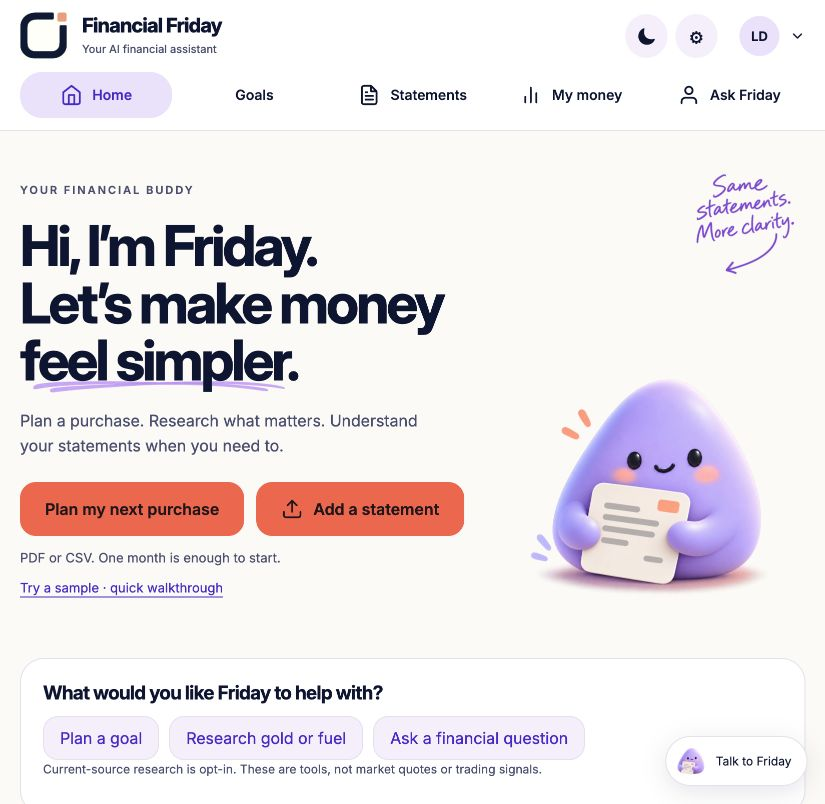
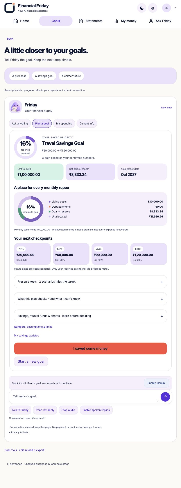
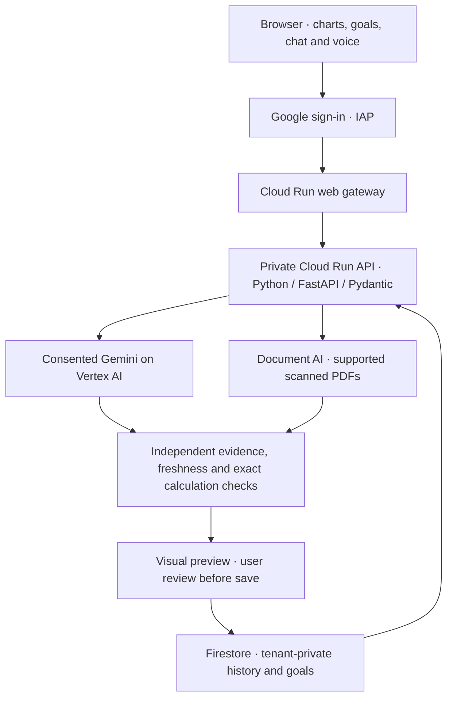

# Financial Friday
### Understand your money. Plan what comes next.

**[Open Friday](https://financial-friday-web-171681243260.asia-south1.run.app/#home)** · **[Judge kit](judge-kit/README.md)** · **[Walkthrough & downloads](https://financial-friday-web-171681243260.asia-south1.run.app/assets/friday-judge-guide.html)** · **[Release evidence](docs/CURRENT_RELEASE.json)**

An India-first financial-assistance prototype for the **Google Cloud AI Builder
Cup 2026 — BFSI: Intelligent Risk, Fraud & Financial Experiences**. Friday turns
supported INR statement history and a conversation about future goals into
reviewed charts, visual cash plans and bounded Google AI guidance. People should
not need to become spreadsheet experts to understand their money.

The contribution is the working combination: Gemini interprets the request,
independent code checks evidence and exact money calculations, and the user sees
a visual, reviewable result. **No bank connection, payment authority, guaranteed
profit, authenticated statements or universal fraud detection is claimed.**

## See it, then try it



| Your input | Friday’s work | Your control |
| --- | --- | --- |
| One supported PDF/CSV | Extracts rows, checks available source facts, groups reviewed history into charts and review candidates | Compare the preview before saving |
| A savings/purchase/reserve goal | Asks for missing facts in chat, builds an allocation ring, dated checkpoints, pressure cases and alternatives | Preview alternatives, confirm one priority |
| A typed or spoken question | Explains consented totals, or retrieves attributed public information using Google Search | Review transcript, sources and assumptions |



### Five-minute judge journey

1. **Sign in with Google.** Top-right **My account** identifies your workspace.
   No bank, Gmail or Drive access. A returning browser may reuse Google sign-in.
2. **[Download one artificial CSV](judge-kit/statements/01-HDFC-Illustration-6-Months.csv)** via Raw → Download, or use the hosted walkthrough downloads.
3. **Home → Add a statement → Read my statement.** Compare **42 transactions,
   ₹3,00,000 in / ₹1,64,694 out**. Confirm the reviewed rows and save.
4. **My money → All entries → Back**. In **Ask Friday → Statements ready · tap
   to share**, permit totals; ask “Show my spending visually and one useful next step.”
5. **Goals:** send the ARTIFICIAL example below; choose **Continue with Gemini**.
   The visual roadmap appears automatically in the same conversation.

> I want a travel savings fund of INR 120000 in 12 months. Monthly income INR 50000, living costs excluding debt INR 30000, monthly debt payments INR 0, liquid savings INR 70000, protected buffer INR 50000.

Expect **₹20,000 starting pot / ₹8,333.34 monthly step**, allocation, checkpoints
and four transparent pressure cases—not forecasts. **Save my roadmap → Confirm
& save** stores a private priority. **I saved some money** records only additional
money actually reported as set aside. **My savings updates → Undo** corrects it.
Imports, time and reduced spending never manufacture savings. No bank money moves.

Try income ₹35,000: feasible alternatives appear. **Preview this option** explores
a smaller target or longer timeline without retyping the budget or changing the
saved priority. Investment cards provide education, not personal product picks.

**[Full click-by-click guide, exact results and troubleshooting](judge-kit/README.md)**.
The five fresh CSVs contain the same invented activity: test **one at a time**,
not as five accounts. Bank names indicate illustrative/candidate heading families,
not certified current exports. [Controls and provenance](judge-kit/manifest.json).

## Voice: explicit, visible, optional

- **Read last reply → Enable voice & read** enables Google speech. Subsequent
  replies can speak automatically while enabled.
- Long answers get a **labelled short spoken preview** using displayed words;
  the complete answer stays on screen. Latest replies queue instead of being lost.
- **Stop audio** cancels playing, queued and still-loading playback. It cannot
  recall a provider request already transmitted. Last-clip replay uses page memory
  without another model call when available.
- If autoplay is blocked, use the visible **Play** control. Quota, sign-in and
  provider failures have distinct messages. Typing/charts remain available.
- **Talk to Friday → Record & send to Google** starts an explicit microphone turn
  of up to 25 seconds. Review the transcript, then Send. **Type instead** needs no mic.
- New chat/cleanup resets speech permission and page-only audio. No wake word,
  background recording, raw audio storage or native Gemini Live session.
  Voice needs the **Vertex-enabled hosted service**; a Developer-API-only local
  configuration cannot provide this path.

Speech can mishear/mispronounce figures. Check them on screen. Human microphone
and speaker testing on the actual demonstration device is still necessary.

## Where AI helps—and where code checks

| Work | Implementation / boundary |
| --- | --- |
| Goal interpretation and missing-fact questions | Gemini on Vertex AI, structured output, quote-bound input checks |
| PDF extraction | Vertex Gemini; configured Document AI OCR for supported scans; source validation |
| Explanations, chart/plan selection, unsent drafts | Bounded Gemini output, optional private aggregates, amount/citation/freshness checks |
| Current public information | Gemini + Google Search grounding; actual sources/Search Suggestions; no private records or history |
| Short voice turns / replies | Vertex Gemini transcription / Gemini TTS; explicit choice, validated audio |
| Known CSV parsing / initial categories | Deterministic adapters and editable local labels; **not trained ML** |
| Reconciliation, allocation and scenarios | Exact integer-paise calculations, not model-invented totals |
| Saving, identity and privacy | Authenticated policy, revisions, privacy generations and replay checks |

Research is retrieved on request, **not a streaming market ticker** or independently
fact-checked recommendation. Cash scenarios do not assume investment returns.
Known inputs and unestablished factors are shown separately.

## Architecture and technology



**Frontend:** HTML/CSS/JavaScript, responsive Soft Studio design.
**Backend:** Python, FastAPI, Pydantic, google-genai.
**Cloud:** Cloud Run, Vertex AI, Document AI, Firestore, Cloud Build, Artifact
Registry, IAM, IAP and Secret Manager. **Local:** Docker, Python 3.12, SQLite.
Ed25519 binds extraction evidence to Friday’s tenant/source/generation:
**Friday’s signature, not the bank’s**. Content-free request IDs link gateway,
API, calculation and model events without logging raw statements/sensitive prompts.

Cloud Tasks retains a narrow historical journal-recovery worker, not bank recovery.
BigQuery, Vertex AI Search, Model Armor, Cloud KMS, ADK, Agora and fine-tuning are
**not claimed as implemented**. Services are named only when they do a demonstrated job.

[Architecture](ARCHITECTURE_GUIDE.md) · [Specification](SPEC.md) ·
[API map](docs/API_MAP.md) · [Security](SECURITY.md) · [Contributing](CONTRIBUTING.md)

## Public source, private workspaces

This repository is **public**: judges can read source and download samples
anonymously. The hosted website still requires Google sign-in; the current IAP
policy admits authenticated Google users. The API remains private. Repository
visibility does not expose visitor records. No security weakening was needed.

Managed Google accounts can have administrator restrictions. A second person's
actual browser login remains a human check; synthetic visitor tests are not OAuth
tests. Cloud Run does not depend on the owner's laptop, but quotas/account policy
and cloud availability can interrupt access. No uptime guarantee is claimed.

Raw uploads are not archived. Reviewed normalised rows and minimal source evidence
are saved after confirmation. Chat receives private totals only when enabled.
**Start a new review** changes source selection without deleting imports.
**New chat** clears page conversation, not saved statements. Privacy deletion is
separate. Never upload PINs, OTPs, passwords or private data for a public demo.

## Run locally

Start Docker Desktop, then from this repository:

```sh
docker compose up -d --build api anthos-demo
```

Open **[Friday](http://127.0.0.1:8090/#home)**. The historical `anthos-demo`
name means Friday's web gateway, **not a Bank of Anthos dependency**.
[API docs](http://127.0.0.1:8080/docs) are for developers.
Use `.env.example`; never commit secrets. CSV/charts work without a model;
PDF/chat/research/voice require configured live services and fail explicitly.
Local and cloud workspaces are separate. Stop with `docker compose stop`;
do not delete volumes to resolve an import conflict.

## Tests and honest evaluation

```sh
PYTHONPATH=src .venv/bin/python -m unittest discover -s tests
PYTHONPATH=src .venv/bin/python -m unittest discover -s tools -p 'test_*.py'
docker compose --profile test run --rm --build tests
```

**0.39.0** counts, skips, source/image identities and actual cloud acceptance scope:
[release report](docs/FINAL_POLISH_0390.md) / [manifest](docs/CURRENT_RELEASE.json).
A commit is not automatically deployed; historical reports retain their dated scope.

**Deployed:** API and web 0.39.0, each at 100% traffic. **868 tests run / 867
passed / 1 skipped** natively and in both Python CI jobs; container **868 / 818 /
50** (environment-dependent skips); **68 tooling tests passed**. Exact-source
[GitHub CI passed](https://github.com/Santxsh27/financial-friday/actions/runs/39130403143).
The final navigation-only web follow-up also passed
[both Python and container CI](https://github.com/Santxsh27/financial-friday/actions/runs/39133138287)
and 33 focused native tests; API and voice code are unchanged.
Eight isolated real-Google calls verified speech/transcription/Search and goal
save/restore/report/Undo. A separate public browser question and TTS call completed
audio playback and cached replay/Stop. Only artificial/general test inputs were
sent; no bank money moved. Hardware microphone/speaker and second-human login
remain manual checks.

The authored 39-case synthetic review-candidate benchmark records **66.67%
precision / 73.68% recall / 38.89% case-level false-positive rate**. This is not
fraud ground truth or independently validated bank accuracy. Misses and false
warnings remain visible. Gemini studies distinguish failures, typed admission,
calculation checks and wording conformance. No universal accuracy, world-first
novelty, patentability or award is established. Broader authorised real-bank cases,
independent frozen AI evaluation and external security/usefulness review remain needed.

## Limits and submission

- INR only; CSV ≤1 MB/500 rows; PDF ≤4 MB/six pages/200 rows.
  Workspace ≤10 imports/2,000 rows.
- Unsupported, ambiguous, encrypted or incomplete inputs can reject safely.
  Reconciliation is not proof of authenticity, completeness or fraud.
- No bank feeds/live balances, payments, subscription cancellation, refund recovery,
  complaint submission, guaranteed savings or personalised securities trades.
- Trial request limits are shared across workflows. Neither request limits nor
  budget alerts guarantee zero cloud cost or uninterrupted availability.
- Historical payment/assurance code remains behind route guards; complete
  separation into services/IAM is not claimed.

Use the deployed link, this public repository and judge kit in the official
dashboard. Complete its required proposal/deck, public demo video, team/eligibility
checks and submission fields. Confirm the dashboard deadline yourself; deployment
does not submit an entry. [Submission checklist](docs/submission/RELEASE_CHECKLIST.md).

On this Mac, source stays in `Desktop/CARAPACE`; fresh upload files and personal
notes are in **`Desktop/Financial Friday Testing`**. Older materials remain
recoverably in ignored `archive/` and `my-testing/`, not the new judge pack.
