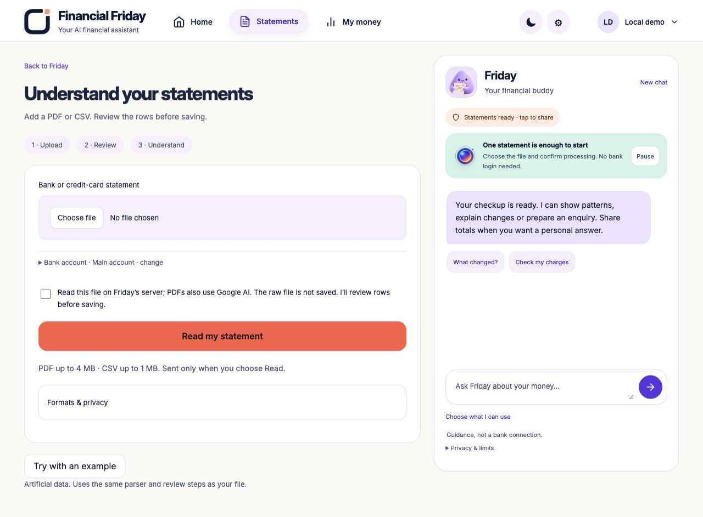
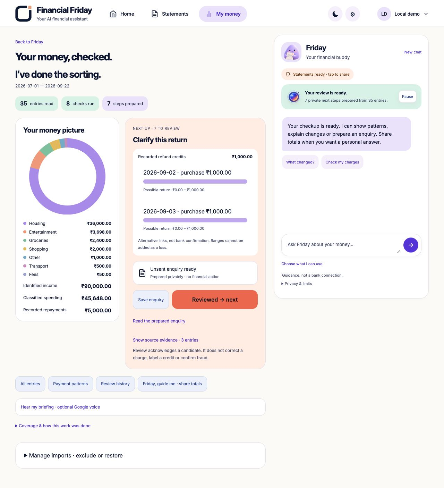
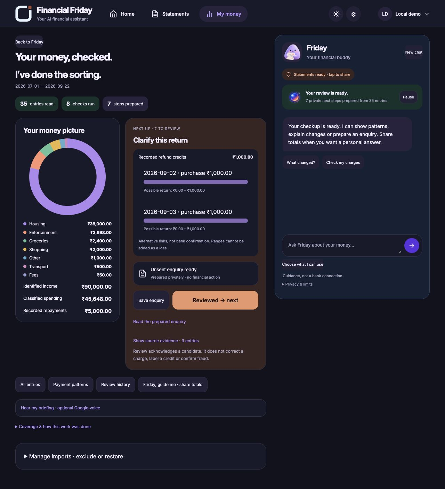

# Financial Friday 0.30 — integrated assistant workbench

16 October 2026. This is a workflow improvement over 0.29, not a claim of a new
financial algorithm, calibrated fraud detection, bank integration or award outcome.

## Product change

One reviewed import now completes the bounded preparation work. The default
result shows a category chart and one priority item with a prepared worksheet or
unsent enquiry. Refund graph ranges are integrated into the relevant task.
Detailed source evidence remains expandable. The guide reacts to actual page
events, not a pretend timer. Account import options are folded away; a single
clearly artificial example runs through normal processing/review/save consent.

## Authority and safety

`ASSISTANT_WORK_1` derives at most eight artifacts per batch, with stable IDs,
source revision/generation/fingerprint and explicit zero-model/zero-external-action
fields. An acknowledgement only records reviewed/open. It neither reclassifies
an entry nor removes an overlap. Repeated rows get comparisons; unclear credits
get worksheets, not complaints. Refund bounds remain conditional alternatives,
not a recovered sum. Cleanup and later evidence invalidate earlier work.

The optional voice briefing sends only a server-composed aggregate script (at
most 50 words) through the existing Vertex client to Gemini 2.5 Flash TTS. Strict
consent, tenant identity, existing quotas, current revision/generation, post-call
freshness and completed PCM checks are required. WAV output is generated in
memory, bounded to 30 seconds, never persisted or auto-played. No microphone or
new service/IAM/OAuth permission is introduced. Audio fidelity is not independently
transcribed or certified; the exact visual figures remain available.

## Verification record

- Native suite: 646 tests run, 645 passed, one optional integration skipped.
- Docker suite: 646 run, 622 passed, 24 optional integration/runtime skips.
- Tool suite: 24 passed.
- Browser: isolated synthetic upload, 35-row proposal, explicit save, automatic
  preparation, downloaded classification worksheet, reversible review queue
  advancement, integrated ambiguous refund ranges and theme switching verified.
- Browser testing found an unfinished sample-token substitution; fixed before
  release. A historical sample test was updated to assert both the old 13-row
  fixture and the actual new 35-row web sample. No precomputed results added.
- A privacy-generation race was fixed: old rows cannot be labelled as a cleared
  generation, and a generation change during analysis rejects the view.
- Client load/save/extraction tickets also discard stale responses after cleanup.
- Initial staged TTS returned 503; its disposable workspace was cleaned up. The
  initial provider failure reason was not logged, so its exact cause remains
  unestablished. A separate synthetic diagnostic correctly rejected over-limit
  audio. The script was shortened to a spending headline and the TTS request got
  its own 60-second, one-attempt timeout. The 30-second output cap was retained.
  One direct shorter synthetic check returned 28.65 seconds of valid audio.
- A subsequent UI review caught a chat-to-visual mismatch: refund selection now
  focuses the refund task; spending-change selection renders actual category
  deltas. These are real source calculations, not an animated success placeholder.
- Live cloud/audio acceptance and immutable release identities are recorded in
  CURRENT_RELEASE only after verification; source work is not deployment proof.
- Final staged acceptance passed: 35 synthetic rows, eight prepared artifacts,
  review advancement with unchanged source rows, real Vertex chat visual selection
  and a 25.69-second Gemini TTS briefing. The successful run made two model calls
  and verified cleanup. Three separate direct diagnostic calls and the earlier
  failed staged request are excluded from that successful-run count, not omitted
  from this record. No owner financial context was used or shared.
- Both final revisions serve 100% of their normal Cloud Run traffic. The canonical
  Google-authenticated browser showed the new sample control and integrated
  workbench, with no console errors observed in that fresh load. This hosted UI
  check made no model call and did not upload or alter owner statements. The API
  still returned 403 to an unauthenticated request. No IAM or OAuth scope changed.

## Screen audit and resulting flow

1. **Upload — improved:** one primary file action, optional collapsed account
   settings, one labelled sample and concise processing consent. No auto-save.
   
2. **Result — improved:** actual completed counts, chart and one prepared task.
   Extra evidence is opt-in rather than a primary wall of prose. The assistant
   remains beside the work without stretching to the entire page height.
   
3. **Theme and phone layout — checked:** opaque logo background blends into the
   header; native controls follow the theme. At 390 px the content is 390 px wide,
   and the prepared task precedes the chart. The temporary viewport was reset.
   Pause/Resume labels and pressed state were checked in the browser.
   

These captures use artificial data. This is a focused workflow, theme and
responsive check, not an independent usability study or accessibility certification.

## Official integration research

Google Pay’s public India API creates merchant payment requests; it is not a
personal-bank-history access API. Google Pay history itself covers Google Pay,
not every UPI or banking transaction. No hidden-account connector was added.

- [Google Pay payment request API](https://developers.google.com/pay/india/api/web/create-payment-method)
- [Google Pay transaction history](https://support.google.com/pay/india/answer/7430307?hl=en-IN)
- [Gemini TTS via Vertex](https://docs.cloud.google.com/text-to-speech/docs/gemini-tts)

The remaining product limitation is unchanged: statements are user-supplied
evidence. Friday prepares and explains; it cannot verify ownership, cancel a real
payment, recover money or monitor a bank account without authorized integrations.
