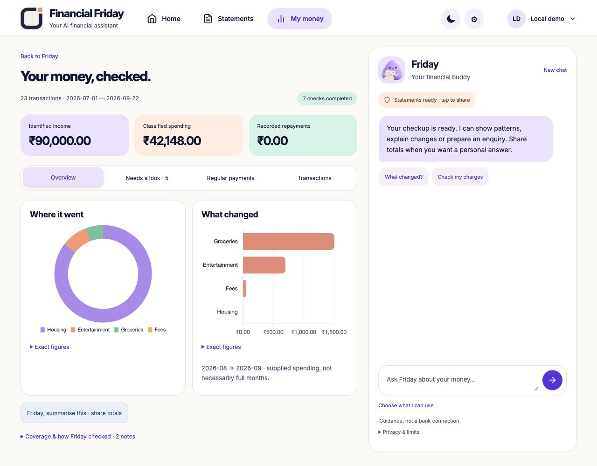

# Automatic statement checkup

Financial Friday 0.28.0 makes the statement upload the start of completed analysis,
not another questionnaire. Home retains the selected Soft Studio companion,
handwritten accents and bright upload button. Primary navigation is Home,
Statements and My money; Friday has a dedicated mobile conversation page.
Account remains at the top right. Rehearsals remain optional additional tools.

## User outcome

Add a supported INR statement, review the proposed rows and save. Friday runs
seven checks automatically and presents Overview, Needs a look, Regular payments
and Transactions. Charts include exact figures; long explanations and import
controls are expandable. A finding has its source rows, an enquiry preparation
button and reversible reviewed/open state. Preparation fills the dates, amounts
and entry descriptions into a downloadable **unsent** enquiry. No bank message
is sent and no refund, cancellation or ledger correction is claimed.

In chat, separately opt into statement totals and derived findings, then ask
“Show my regular payments” or “Prepare an enquiry for the repeated entry.”
Gemini selects a strict visual/artifact request; server code validates the finding
and source before preparing the result. The model does not receive transaction
descriptions, account aliases, source hashes or row references. No model is
trained on private statements. General questions need no financial context.

## Algorithms and limits

- **Matching entries:** same account nickname, date, normalized exact description,
  debit and credit. All occurrences stay counted. Different exports may overlap;
  matching amounts alone are never treated as proof of duplicate payment.
- **Regular payments:** same account, exact description, kind and category; one
  debit in each of at least three consecutive months, with 20–40-day intervals.
  Ambiguous multiple-occurrence months are not merged into a recurring series.
- **Amount changes:** latest regular amount at least 15% and INR 100 above its
  earlier lower median. Tariff/usage changes can explain a candidate.
- **Unusual amounts:** at least six earlier expenses in the same account/category;
  latest-supplied-month amount exceeds max(three times lower median, median plus six
  median absolute deviations, median plus INR 1,000). This is an explainable
  heuristic, not a calibrated anomaly probability or trained fraud model.
  Overlapping imports can distort this baseline; review coverage notes first.
- **Fees and unclear credits:** source-linked grouping. Unclear credits are not
  earnings; recorded fees are not automatically unauthorised or refundable.
- **Change attribution:** exact per-category differences between consecutive
  supplied months sum to the total classified-spending difference. Missing months
  are not zero; partial months are not treated as proven full-month behaviour.

Known techniques are deliberately used with evidence and permission boundaries.
There is no claim of a novel statistical theorem, world-first product, independent
fraud accuracy, guaranteed savings or hackathon selection. Real bank-format,
false-warning and user-outcome validation remains necessary.

## Safety and storage

`GET /v1/friday/statements` derives `checkup` without model calls or writes.
Enquiry preparation is read-only. Review/reopen recomputes finding membership
inside the tenant's portfolio transaction. Unknown IDs, stale revisions, cleared
generations, extra authority fields and cross-tenant requests fail closed.
The Google login scopes, private API IAM, canonical-origin guard, payment limits,
signing keys and Cloud Tasks target are unchanged.

Gemini uses schema-constrained responses; application validation still checks
evidence IDs, supported amounts, permission scope and conflicting workflow
proposals. A schema is a format boundary, not factual verification. See
[Google's structured output documentation](https://cloud.google.com/vertex-ai/generative-ai/docs/multimodal/control-generated-output).

## Verification

- Native suite: **599 run, 598 passed, one optional skip**.
- Container suite: **599 run, 575 passed, 24 optional skips**.
- Tooling suite: **24 passed**. Final presentation follow-up: **22 passed**.
- Two real Vertex calls in a fresh artificial workspace selected the regular
  payments visual and prepared the repeated-entry enquiry. Five candidates and
  two regular series were computed from 23 uploaded rows. Firestore persisted
  review/reopen without changing source transactions. Test workspace cleanup was
  verified. No owner statement was shared, changed or uploaded for this test.
- Local browser: upload → review/save → charts → source entries → actual prepared
  enquiry → review → reopen; regular-payment display; zero observed console errors.
- Responsive check: 390 × 844, document width 390; corrected amount wrapping.
  Light/dark chart labels and reduced-motion handling use the active preferences.

The synthetic CSV is [friday-checkup-artificial.csv](../examples/friday-checkup-artificial.csv).
Expected income INR 90,000; classified spending INR 42,148; five review candidates;
two recurring patterns; August-to-September spending change INR 2,248. These are
fixture expectations, not a fraud benchmark. Fresh amounts/descriptions are parsed
again; the application does not return a predefined answer for this filename.

Immutable source commits, Cloud Build images, traffic and current activation
are recorded in [CURRENT_RELEASE.json](CURRENT_RELEASE.json).

