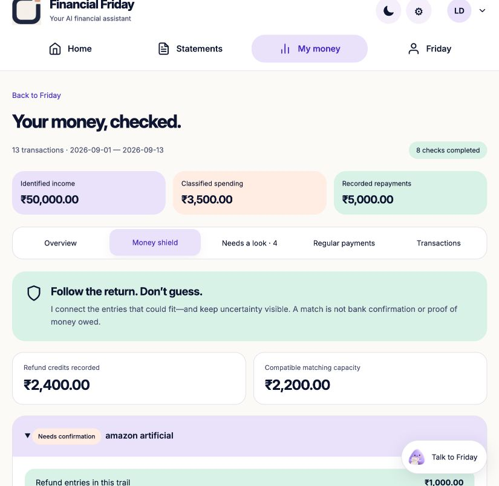

# Money Shield — ambiguity-aware refund evidence

16 October 2026 · source 0.29.0 · deployed identities in [CURRENT_RELEASE.json](CURRENT_RELEASE.json).

## What changed and why

Friday remains one statement-first financial buddy, not a new collection of
financial apps. Its automatic checkup now follows purchase/refund trails as well
as spending patterns, and prepares a clarification when the evidence needs one.
The user uploads and reviews once; matching, alternative-allocation analysis,
source assembly and exact visualization happen on the server.

The supplied brainstorming proposed legal refund recovery, tax reconstruction,
unused-subscription detection and corporate forensic audits. Those were not
implemented: statement rows alone cannot establish entitlement, authorisation,
subscription use, illegality or a tax deduction. Adding such claims would make
the product less trustworthy. The chosen upgrade makes a specific, difficult
part reliable instead: **never silently turn an ambiguous refund into certainty**.

## Algorithm: REFUND_FLOW_1

1. Read validated EXPENSE debits and REFUND credits; income, loans and transfers
   are excluded. All monetary calculations use integer paise.
2. Group by literal normalized merchant text and account nickname/type. Remove
   only explicit leading payment/refund language and trailing reference fields.
   No fuzzy identity matching or ownership inference occurs.
3. Create an edge only when the purchase is no later than the refund and within
   90 days. Same-day matches are permitted. This is a declared compatibility
   hypothesis, not an authenticated transaction relationship.
4. Solve maximum flow F in the refund→purchase capacity graph. Each refund's
   capacity is its credit; each purchase's capacity is its debit.
5. For every purchase j, hold total flow F fixed, then minimize and maximize its
   incoming allocation using min-cost flow (cost +1 / −1 on j's sink edge).
   Those two optima are its tight bounds across maximum compatible allocations.
6. Independently check primal edge compatibility, integer nonnegative amounts,
   capacity and conservation. Check the residual graph for negative cost cycles
   and nonnegative reduced costs; check maximum-flow reachability. These verify
   the calculation's optimum, not actual banking identity or a refund promise.

The residual network uses Bellman–Ford shortest augmenting paths. There are at
most eight purchases and eight refunds per solved group, and 32 solved groups.
Group overflow or repeated row identities withhold the entire group's allocation.
No row is discarded to force a match. Generic merchant descriptions and missing
purchase history remain unlinked. At most 40 trails are expanded in the UI;
all source transactions stay accessible. Local processing adds zero model calls.

**Bounds are not independent money pots.** If a single ₹1,000 refund fits two
₹1,000 purchases, each may have a ₹0–₹1,000 range, but both cannot receive ₹1,000
simultaneously. The UI states this explicitly. Unique allocation is conditional
on the graph assumptions. The 90-day window is a product bound, not a legal rule.

## Google AI and the authority boundary

The existing Google stack remains: Python/FastAPI containers on Cloud Run,
tenant-scoped Firestore, Gemini on Vertex AI, and the existing Document AI OCR
path for supported scanned PDFs. No additional API or OAuth scope is required.
CSV parsing and the graph solver are deterministic; PDF interpretation and
conversation are meaningful bounded Gemini tasks, not a model doing arithmetic.

Separately opted-in chat context contains formatted aggregate amounts, derived
counts and bounded finding IDs. It excludes raw transaction descriptions, account
nicknames and row/file identities. `MONEY_SHIELD` selects a visual; a valid
`PREPARE_ENQUIRY` request selects a current finding. The server fills source dates
and amounts privately. Tenant/revision/privacy-generation, schema, citation,
amount and canonical-origin checks remain in force.

Completion receipts for these operations are server-owned. Even if a model
returns “I recovered your money” or “I sent a legal demand,” the returned operation
message reports the real local result: a visual or an **unsent** enquiry. With no
shared/saved context it reports that no personal check was completed. This is a
specific authority firewall, not a guarantee that every free-form answer is true.
Gemini has no arbitrary code, SQL, bank, browsing or sending tools in this path.

No statement weights are trained. No local WebGPU redactor, legal filing service,
autonomous cancellation, fraud classifier or payment-blocking bank integration
was added. Existing Google login is not consent to access a bank, Gmail or SMS.

## Try the complete demonstration

**Statements → Download Money Shield example → choose that CSV → Read → review
13 rows → Save → My money → Money shield.** The same test file is
[friday-money-shield-artificial.csv](../examples/friday-money-shield-artificial.csv).

| Artificial trail | Result |
| --- | --- |
| Two Amazon purchases, one ₹1,000 refund | Both ₹0–₹1,000; ambiguous, no chosen purchase |
| Metro purchase ₹500, refund ₹200 | Exact conditional match ₹200; remainder is not automatically owed |
| Book purchase ₹1,000, refunds ₹600 + ₹400 | Split credits can cover the purchase under assumptions |
| Old-store ₹150 refund | Original purchase absent; stays unlinked |
| Generic ₹50 refund | Merchant missing; stays unlinked |

Totals: ₹2,400 refund credits, ₹2,200 compatible capacity, ₹200 unallocated.
Salary remains ₹50,000; a ₹10,000 loan credit is not added as earnings. Classified
spending remains ₹3,500 and loan repayments ₹5,000. The engine does not silently
net refunds against spending or rewrite prior totals. These are fictional tests,
not recovered money or real-world efficacy measurements.

**Open clarification case → Prepare bank enquiry** assembles the sources. It
never sends a complaint. With explicit aggregate sharing, ask Friday **“Show my
Money Shield”** or **“Prepare an unsent clarification for the refund ambiguity.”**
The model can route to the visual and ask the server to prepare the artifact.

## Verification and release evidence

- Native suite: 610 tests run, 609 passed, one optional skip.
- New module: 11 test methods, including an independent exhaustive oracle over
  80 fixed-seed small integer graphs. All feasible edge allocations are enumerated
  separately, then compared with maximum total and every purchase's lower/upper
  optimum. This tests mathematical correctness, not financial truth.
- Repeated/oversized groups, account/date boundaries, 90-day limit, split/partial
  returns, reorder stability, generic descriptions and unchanged source rows tested.
- API tests exercise no-consent context, fabricated model completion messages,
  source-grounded unsent drafts, no payment authority and unchanged portfolio/
  sandbox state. Existing tenant/stale revision checks remain covered.
- Local browser acceptance used only a separate artificial workspace: upload,
  review/save, automatic shield, source table and enquiry assembly.
- Container suite: 610 run, 586 passed, 24 optional skips (no user volumes mounted).
- Tooling suite: 24 passed. Follow-up graph/checkup/full-UI syntax checks: 33 passed.
- Phone check at 390 × 844: content width 390; tabs scroll internally. Light/dark
  themes and exact amounts were inspected; temporary viewport was reset afterward.
- Live cloud acceptance results will be recorded here after checks; deployment
  is not inferred from a passing unit test or Git commit.

`tools/verify_refund_shield_cloud.py` exercises the same CSV, live Vertex visual
selection and source-filled draft in a newly generated synthetic cloud workspace.
It reads back unchanged sources/rules and clears only that disposable identity.
It never submits a payment or reads the owner's statements. Credentials stay in
memory and are not printed. Live checks consume a small amount of existing trial
allowance; no zero-cost promise is made.

## Where novelty and product value actually sit

Graph flow, grounding and restricted AI actions are established techniques.
There is no claim of a new theorem, world-first, patent eligibility or guaranteed
hackathon result. The differentiating implementation is the combination of
automatic ambiguity bounds, inspectable source evidence, a consent-minimized
Gemini interface and server-owned completion receipts in a low-effort consumer
journey. It does useful assembly and calculation beyond describing a CSV.

Still required for production: representative bank-export evaluation, calibrated
false-warning/usability studies, independent security review, lifecycle/cost
monitoring and any licensed partner integration needed for real action. A
statement-only product cannot verify every refund, prevent an unrelated live
payment, establish account ownership or guarantee recovery. Missing history,
changed merchant strings, mistaken labels and reused account nicknames can limit
or invalidate a candidate match. Keep those boundaries visible.
