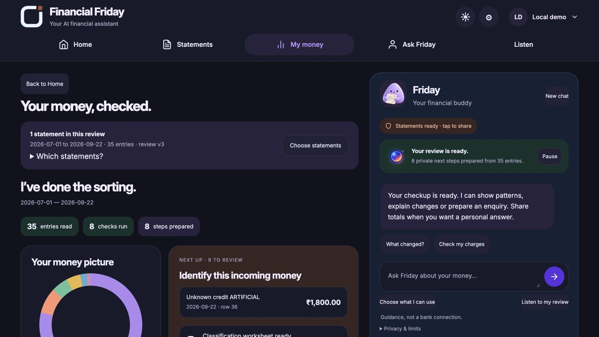
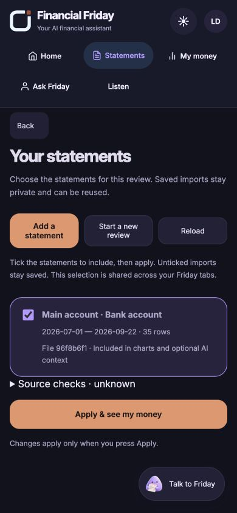
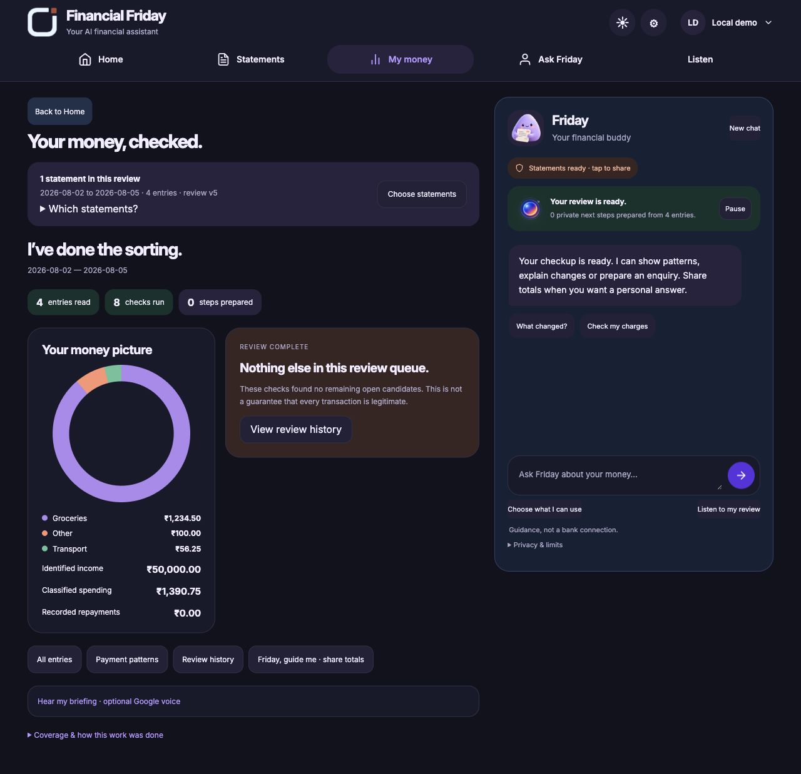

# Statement workflow repair

17 October 2026. Local source version 0.33.0. This is a staged repair, not a
claim that every page, bank export or production integration is finished.
The hosted deployment remains 0.32.0; CURRENT_RELEASE preserves its identities.

## Audit scope and outcome

The goal is one understandable journey: upload, review, select sources, understand
the result and ask Friday. The selected Soft Studio design is preserved.
Current-run browser captures established the following issues:

| Step | Before | Local repair and verification |
| --- | --- | --- |
| 1 Home | Clear upload action; no obvious voice entry | Approved hero retained; Ask Friday and Listen visible in navigation |
| 2 Upload | No visible connection to previously saved imports; account nickname folded away | Selected-source banner and visible account controls |
| 3 Preview/save | Reload recovery existed, but returning after save could reopen an empty preview | Preview recovery retained; completed/cancelled preview history entry replaced |
| 4 My money | Combined history without an upfront source list; voice folded below results | Visible count/date/revision banner, source list and Choose statements |
| 5 Detail views | Same hash for different money views; Back always meant Home | Detail hashes and history-aware Back; direct-link parent fallback |
| 6 Chat | AI results could switch pages automatically | Results prepare privately; explicit Open button chooses navigation; reply receipt identifies selected review |
| 7 Fresh review | No reversible central fresh-start action | Atomic selection of zero sources; saved history remains restorable |
| 8 Optional tools/profile | Overlapping labels and older tools in the same navigation | One optional-tools group; profile remains in top-right account menu |
| 9 Responsive header | New voice entry initially overlapped theme controls | Measured and corrected header height and laptop wrapping; phone navigation uses two rows |

Current audit screenshots are stored in the task's `audit-navigation-0330`
directory. The committed screenshots below contain only the isolated artificial
35-row sample. No owner statement screenshot is committed. An intermediate
loading screenshot was rejected as final evidence.

## Data and safety contract

`POST /v1/friday/statements/selection` takes included source hashes, expected
revision and privacy generation. The API verifies membership in the authenticated
tenant and updates exclusions in one SQLite/Firestore transaction. Unknown
sources, stale revisions/generations and cross-tenant requests fail. An identical
current selection is a no-op. No statements or acknowledgements are deleted.

Charts, exact checks and optional Gemini totals use the same selected sources.
Source changes invalidate stale chat/plan displays. Each import now exposes its
date range. A confirmed re-import of an identical excluded source restores it
with a current revision rather than silently leaving an empty analysis.

No new Google scopes, payment permission, public API exposure or financial
execution route was added. Fresh review does not use privacy cleanup. Excluded
sources still count toward existing storage caps. Original filenames/raw files
are not retained; nickname, dates, row count and short file identity identify imports.

## Bank export work

The deterministic BANK_EXPORT_V2 adapter supports a finite set of financial
heading aliases, known metadata columns, recognised preambles and additional
explicit day-first date spellings. It preserves original physical source rows
and exact integer-paise amounts. Ambiguous duplicate financial columns, unknown
table columns, unexplained preamble rows, malformed row lengths, wrong currency
and card/bank semantic confusion fail without partial results.

The ICICI-shaped case is synthetic. It has serial/value/transaction-date fields,
transaction remarks, withdrawal/deposit INR fields, running balances and a report
preamble. These tests do not certify actual ICICI exports or every bank format.
No balance direction/opening balance is invented to force reconciliation.
Existing PDF/scan source grounding and size/page/row limits remain in place.

### Public-format compatibility checks

Official [HDFC](https://www.hdfc.bank.in/terms-and-conditions) and
[Kotak](https://www.kotak.bank.in/en/get-help/accounts.html) public account
illustrations informed two new synthetic CSV fixtures. These are illustrative
table headings/literal styles, not current export specifications. ICICI's own
[online services page](https://www.icici.bank.in/personal-banking/ways-to-bank/net-banking/online-services)
confirms PDF/CSV downloads but not its precise headings; that fixture is explicitly
a candidate. Two generic delimiter/column-order variants make five fixtures.
Sources checked 17 October 2026. No searched customer records were reused.

The adapter now selects comma/semicolon/tab by an explicit header, handles
BOM-marked UTF-16 without lossy replacement, supports finite INR/English ordinal
date spellings, and treats a dated opening row as a fact rather than income.
Two explicit withdrawal/deposit header sequences may establish bank balance
direction. Other conventions remain unknown. New tests check exact totals,
physical rows, source literals, invalid encodings, unsupported directions and a
deliberately changed running balance. Model calls for these CSV checks: zero.
No model training or universal bank-format claim is made.

Fixtures and their expected outputs: [judge bank-format guide](../jugges/bank-formats/README.md).
Versioned inputs: `examples/friday-bank-format-cases.json`.

## Verification

Initial complete local run: 759 tests, 758 passed, one skipped.
Initial complete Docker run: 759 tests, 734 passed, 25 skipped. Docker uses its
actual installed dependency set; skipped checks are not counted as passes.
Final run results are recorded below when complete.

Final native run after the zero-findings guide correction: **770 tests, 769
passed, one skipped**. The five synthetic bank-layout cases matched their
independent integer-paise controls. The browser imported the Kotak-style file,
confirmed four rows / INR 50,000 incoming / INR 1,390.75 outgoing, saved it only
in an isolated test workspace, and followed transaction detail → Back.
The zero-findings companion no longer directs a user toward a nonexistent
highlight. No new browser console warnings/errors were captured.

Final Docker run: **770 tests, 738 passed, 32 skipped**. The container intentionally
has no Node runtime, so JavaScript execution checks are skipped there and run
natively instead. One user-fixture byte comparison is skipped because the guide
folder is excluded from the image; the versioned fixture inputs are still tested
inside Docker. The pre-existing optional integration skip is not a pass.
Local API and website were rebuilt with the final changes and their saved volume
was retained. A browser tab opened during restart briefly hit connection-refused;
the rebuilt listener was checked again after startup.

The added journey tests cover reversible/atomic selections, restore by confirmed
re-import, stale/no-op handling, unknown sources, tenant isolation, simultaneous
selections, scoped chat receipts, route resolution and synthetic export variants.
Firestore selection callbacks were exercised through the existing transactional
memory driver, not a new live Firestore selection test.

Browser walkthrough on isolated local SQLite: example upload, preview/save,
transactions deep-link and Back, fresh review, restore without re-upload,
voice disclosure, account/menu entry, plan entry, phone Home/library, header
measurement and no captured console errors. It made no new live Google model
calls and did not mutate the owner's saved workspace.

## Desktop organization

The canonical working path stays `Desktop/CARAPACE`, avoiding path/volume changes.
The old Submission folder moved to `archive/older-submission-2026-10-08` with
the same inode and 138 file entries. Former Test Kit and Test Statements folders
moved to `my-testing/guide-kit` and `my-testing/scenarios` with the same inodes and
original 9/6 entries. No files were deleted. The iCloud-dataless archive was not
hydrated or verified as an independent local backup.

`jugges` contains only copied artificial samples and a walkthrough. Copied CSV
SHA-256 values match their originals. Archive/private testing paths are ignored
by Git, Docker and gcloud uploads. Current root guides replace the older tours;
their prior versions remain in the ignored local archive and Git history.

## Remaining acceptance work

1. Validate authorised, redacted real ICICI PDF/CSV exports and add regression
   fixtures without personal information. Broader bank compatibility remains bounded.
2. Finish every optional-tool state, keyboard/screen-reader review, refresh and
   error-recovery walkthrough. Screenshots alone do not establish accessibility compliance.
3. Delayed plan and rehearsal guards now invalidate missing/changed sources;
   actual submit/renderer JavaScript is regression-tested. Complete the remaining
   browser-level simultaneous-edit and error-path walkthroughs.
4. Stage the new API/web on Cloud Run, test real Firestore selection conflicts and
   a consented synthetic Gemini/voice journey, then promote matching revisions.
5. Update hosted judge instructions only after deployment, so reviewers do not
   receive instructions for controls that exist only in the local repair.
